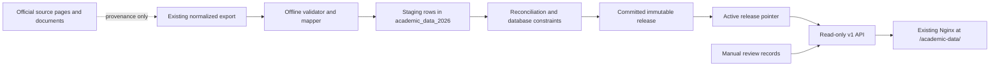

# Academic data service architecture

## Boundary

`services/academic-data` is a standalone, read-only API and importer for source-backed university facts. It owns the `academic_data_2026` PostgreSQL database and its Alembic chain. It does not import the Andromeda core ORM, use the core database URL, run parsers, or fetch university websites during import.

The current release covers BMSTU bachelor's admissions for 2026 and the Moscow head campus. Applicant scores, personal records, and olympiad records are excluded from both the API and service schema.

## Components and data flow

The importer accepts a previously captured directory or ZIP and does not invoke source parsers or make network requests. A successful commit activates the release in one transaction. Failed or staging releases are never visible to the read API. Database triggers allow the active pointer to target only committed, reconciled releases and prevent an active release from becoming invalid.

## Ownership and connections

| Role | Use | Rights |
| --- | --- | --- |
| `academic_data_migrator` | Explicit one-shot Alembic command | Owns the service schema and runs DDL |
| `academic_data_importer` | Explicit validated bundle import | Row-level select/insert/update/delete; no DDL and no migration-version writes |
| `academic_data_api_reader` | API and readiness checks | Select only; no sequence or write rights |

The API uses one small bounded SQLAlchemy pool, one Uvicorn worker, read-only transactions, statement timeouts, and a request deadline. Application startup never migrates or imports. On the live VM PostgreSQL is reached over a local Unix socket using peer authentication; its TCP listener remains loopback-only, and Uvicorn binds only to `127.0.0.1:8010`.

## Canonical keys and links

Every public entity has a stable `external_key`; official codes are retained where the source provides them. PostgreSQL UUIDs remain internal. A relation is created only from a source's explicit association or an official code. Unresolved admission links keep the source row and source code while returning a `null` canonical key plus a resolution status and manual-review context.

Departments are canonical entities. Directions link to departments and programs, while profiles can have multiple department relations such as `owner`, `coordinator`, or `teaching`. These links are stored in dedicated release-scoped tables with composite foreign keys and source-evidence bridges.

## Provenance and history

`source_artifacts` identify captured pages/documents with requested and final URLs, fetch time, SHA-256, and storage state. `source_evidence` records the field, locator, claim, observation time, and verification state. Critical entities use typed evidence bridge tables so the database can check that evidence points to an entity in the same release.

Each import creates an immutable `data_releases` row. Mutable university assertions such as tuition, quotas, exams, requirements, and admission statistics are retained per release. Source-valid time (`valid_from`/`valid_to`), source-observed time (`observed_at`), and database ingest time (`ingested_at`) are separate. Unknown source dates remain `null`.

## Admission requirements

Requirements are ordered trees, not a flattened list. Nodes retain `AND`, `OR`, or `AT_LEAST`, the threshold, child order, leaf/exam fields, and evidence. Decision-engine policy packs are a separate model family; no BMSTU eligibility policy pack is fabricated from the admissions requirements.

## Deployment shape

The live VM runs Ubuntu 22.04 with PostgreSQL 16, systemd, and Nginx. A one-worker API systemd service runs under the read-only database-reader identity with a 256 MiB memory cap and a 50% CPU quota. The Nginx location is included in the existing BMSTU virtual host, so the visualizer remains at `/bmstu-2026/` and the API is served at `/academic-data/` over the same HTTP IP address. PostgreSQL and Uvicorn are not publicly exposed.

The Compose and Caddy files remain local alternative/test wiring; they are not the production VM deployment. The live database, service unit, Nginx include, verified bundle import, backup, and readiness route are recorded in [the release record](release-record-2026-10-03.md).
